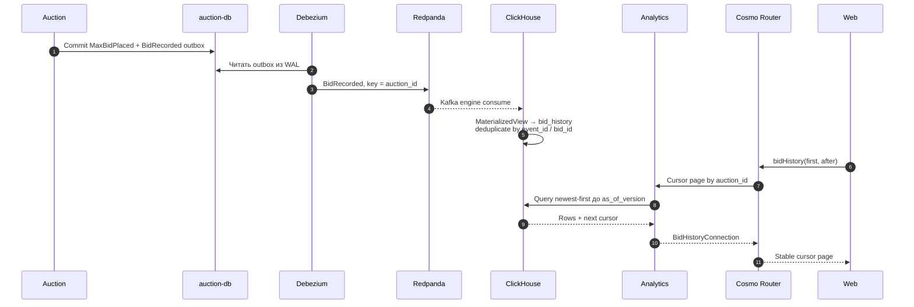

# Полная публичная история ставок

Контекст: Analytics · Актор: участник · Диаграмма: `flow.c4` → `flow_bid_history`

## Цель

Показать все принятые ставки конкретного аукциона, включая ставки, после которых публичная цена не изменилась, без раскрытия секретных максимумов и идентичности пользователей.

## Публичная запись

`BidRecorded { bid_id, auction_id, bidder_alias, resulting_price, occurred_at, version }`

- `bidder_alias` стабилен только внутри одного аукциона и не позволяет связать пользователя между лотами.
- `resulting_price` — публичная цена после принятия ставки, а не предложенный максимум.
- Для каждой принятой команды существует ровно одна логическая запись; технические повторы дедуплицируются по `event_id`/`bid_id`.

## Поток

## Ограничения

- История eventually consistent. Первая страница фиксирует `as_of_version`; cursor следующих страниц несёт этот high-water mark и последнюю позицию, поэтому новые ставки не создают пропуски/дубли в текущем обходе. Текущая цена всегда читается из Auction.
- Даже для hot lot с миллионом ставок ответ никогда не возвращает всю историю одним payload: используется непрозрачный cursor на Auction version и ограниченный `limit`.
- Приватный event store остаётся полным внутренним аудитом, но не используется как публичная read model.
