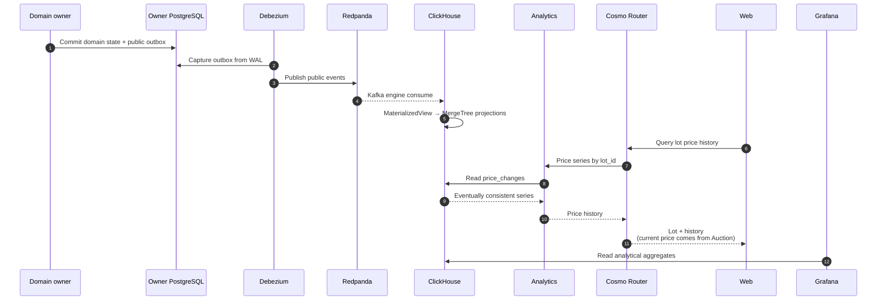

# История цены и дашборды

Контекст: Analytics · Акторы: участник (график), оператор (Grafana) · Диаграмма: `flow.c4` → `flow_analytics`

## Цель
Показать график цены лота за всё время и дашборды по торгам: средняя closing price по категориям, активность по часам, конверсия первого settlement candidate в подтверждённого Winner.

## Логика

## Ограничения
- Отставание секунды. Для графика приемлемо, для цены — нет.
- Только вставки, обновлений нет. Переигрывание — пересоздать MV и прочитать топик с начала.

## Запросы, которые должны быть быстрыми
- Ряд цены по лоту.
- Средняя цена закрытия по категории за период.
- Доля аукционов, оплаченных первым кандидатом; среднее число settlement rounds до `WinnerConfirmed`.
