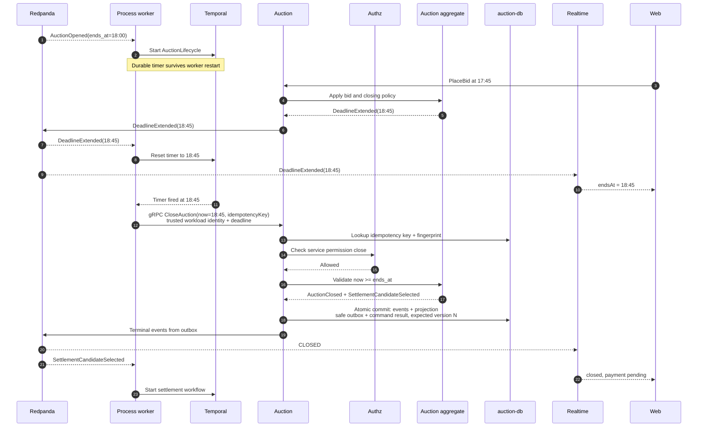

# Закрытие по дедлайну

Контекст: Auction · Актор: время (Temporal) · Диаграмма: `flow.c4` → `flow_timer_close`

## Цель
Закрыть приём ставок, когда наступил `ends_at`, и выбрать первого settlement candidate. Победитель подтверждается позже, после оплаты.

## Варианты политики
| Конфигурация | Поведение |
|---|---|
| `scheduled_end` | Закрытие в назначенное время |
| `inactivity` | Закрытие, если после последней ставки прошло окно без новых ставок |
| оба | `max` из двух: плановое время, но каждая ставка в окне продлевает |
| + `hard_deadline` | Потолок, дальше не продлевается |

Формула и правила — в [README контекста](../../README.md#closing-policy).

## Разделение ответственности
- **Агрегат** при каждой ставке пересчитывает `ends_at` и пишет `DeadlineExtended`. Решение о продлении — здесь.
- **Workflow `AuctionLifecycle`** (Temporal) держит durable-таймер на текущий `ends_at`, сбрасывает его по `DeadlineExtended` и `AuctionRescheduled`, по срабатыванию шлёт `CloseAuction(now)`. Решений не принимает.

## Основной сценарий

## Альтернативы и ошибки
- Дедлайн сдвинулся, пока команда летела → typed gRPC rejection `too_early`; workflow перечитывает `ends_at` и ставит таймер заново.
- Повтор того же `CloseAuction` с тем же idempotency key → сохранённый typed success без новых событий. Повтор после уже закрытого аукциона с новым key → typed terminal/domain outcome без повторного append.
- Неверная workload identity → `UNAUTHENTICATED`; Authz deny → `PERMISSION_DENIED`; timeout, dependency failure или исчерпанный OCC retry → retryable gRPC status.
- Ставок не было → `AuctionClosed`, `AuctionUnsold`.

## Важно про кандидата
Первым settlement candidate становится **лидер**, а не «сделавший последнюю ставку». Последняя ставка могла лишь поднять цену лидера. Winner появится только после успешной оплаты; при forfeiture Auction пересчитает следующего кандидата.

## Инварианты
5, 6, 7 из README контекста. Для политики с `inactivity`: в закрытом аукционе нет ставок в последнем окне.
