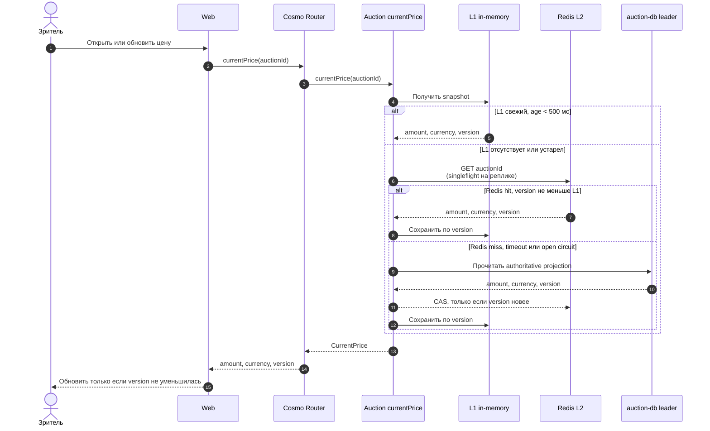

# Получить текущую публичную цену

Контекст: Auction · Актор: участник или анонимный зритель · Диаграмма: `flow.c4` → `flow_get_current_price`

## Цель

Вернуть публичную текущую цену аукциона с версией snapshot за P99 `< 200 мс`. Секретные максимумы участников в этот read model не попадают.

## Основной сценарий

Ошибка заполнения Redis не превращает успешное чтение PostgreSQL в ошибку пользователя. При L1 miss/stale конкурентные запросы одного `auction_id` объединяются через singleflight.
Если Redis вернул snapshot старее уже известного L1, reader не понижает версию и сверяется с authoritative PostgreSQL. Redis timeout и открытый circuit breaker следуют тому же fallback path.

## Обновление L2

После commit `PriceChanged` публикуется через outbox. Price-cache projector читает событие at-least-once и выполняет atomic compare-by-version в Redis. Повторная или запоздалая версия безопасно игнорируется.

## Инварианты

- «Текущая цена» — публичная вычисленная цена, не секретный максимум лидера.
- Cache state не участвует в `PlaceBid` и других командах.
- Значение с меньшей `version` никогда не заменяет значение с большей версией.
- Cache miss всегда восстанавливается из authoritative проекции.
- Subscription остаётся основным live transport; query предназначен для initial load, explicit refresh и восстановления.
