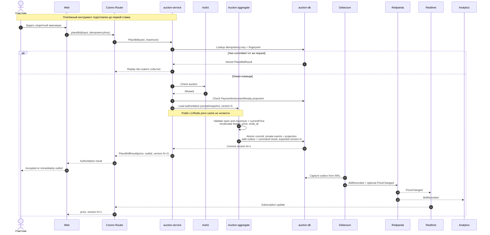

# Ставка

Контекст: Auction · Актор: участник · Диаграмма: `flow.c4` → `flow_place_bid`

## Цель
Участник задаёт максимум по лоту. Система принимает ставку, пересчитывает лидера и цену, уведомляет подписчиков.

## Предусловия
- Участник аутентифицирован, `user_id` из JWT.
- Auction имеет актуальную проекцию `PaymentInstrumentReady(user_id)` из Payments.
- Торги открыты, `now < ends_at`.

## Основной сценарий

## Альтернативы и ошибки
- `max ≤ текущей цены` → GraphQL `DOMAIN_REJECTED`, reason `maximum_not_above_current_price`.
- Торги закрыты → `DOMAIN_REJECTED`, reason `not_open`/`bidding_ended`.
- Конфликт версии (параллельная ставка) → сервис повторяет команду на актуальном состоянии; клиенту возвращается результат пересчёта, не ошибка.
- Повтор с тем же `Idempotency-Key` → тот же ответ, без второго события.
- Тот же key с другим request → `IDEMPOTENCY_CONFLICT`; исчерпан bounded retry → retryable `CONTENTION`.
- Понижение своего максимума → `DOMAIN_REJECTED`, reason `maximum_not_raised`.
- Нет готового способа оплаты → `PAYMENT_METHOD_REQUIRED`; Authz deny → `FORBIDDEN`; timeout/transport Authz → retryable `DEPENDENCY_UNAVAILABLE`.

## Инварианты
1–4 из [README контекста](../../README.md). Ключевое для Lean: `apply(state, MaxBidPlaced)` сохраняет «цена не убывает» и «лидер держит наибольший максимум».

## События
`MaxBidPlaced` (приватное); `BidRecorded` (публичное для каждой принятой ставки); `PriceChanged` и `DeadlineExtended` (публичные при соответствующем изменении).

## Открытые вопросы
- Сериализация команд по `auction_id` внутри сервиса (актор) для горячих лотов — после нагрузочных тестов.
