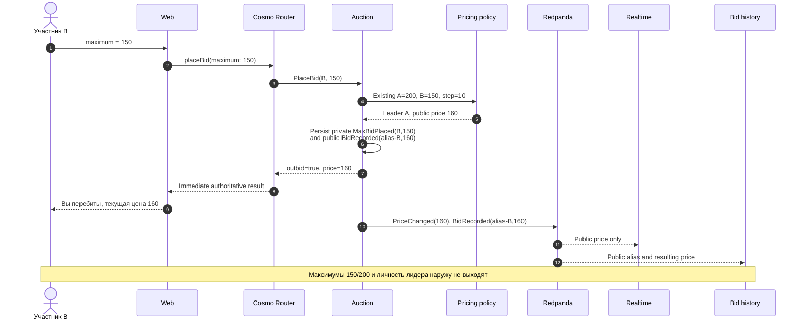

# Автоставка (proxy bidding)

Контекст: Auction · Актор: участник · Диаграмма: `flow.c4` → `flow_proxy_bid`

## Цель
Участник не следит за торгами вручную: задаёт максимум, система ставит за него ровно столько, сколько нужно для лидерства.

## Логика
Это не отдельная команда, а поведение `PlaceBid` под Pricing policy:
- Лидер — наибольший максимум, при равенстве — раньше поданный.
- Цена = `min(max_лидера, max_второго + шаг)`.
- Максимумы и личность лидера секретны. В публичной проекции — псевдоним автора ставки и результирующая цена.

## Пример

A держит максимум 200 при цене 100, шаг 10. B ставит максимум 150.

## Граничные случаи
- B ставит 200 (равен максимуму A): лидер A, цена 200.
- B ставит 250: лидер B, цена `min(250, 200 + 10)` = 210.
- A повышает свой максимум до 300, будучи лидером: цена не меняется, приватный `MaxBidPlaced` и публичный `BidRecorded(alias-A, 100)` есть, `PriceChanged` нет.

## Инварианты
2, 3, 8 из [README контекста](../../README.md). Инвариант 8 (эквивалентность последовательному перебиванию) — главная цель Lean-доказательства в проекте.

## Почему внутри агрегата, а не доменный сервис
Работает только над состоянием одного аукциона и защищает его инварианты. Доменным сервисом стало бы, если бы учитывало, например, бюджет участника по всем лотам.
