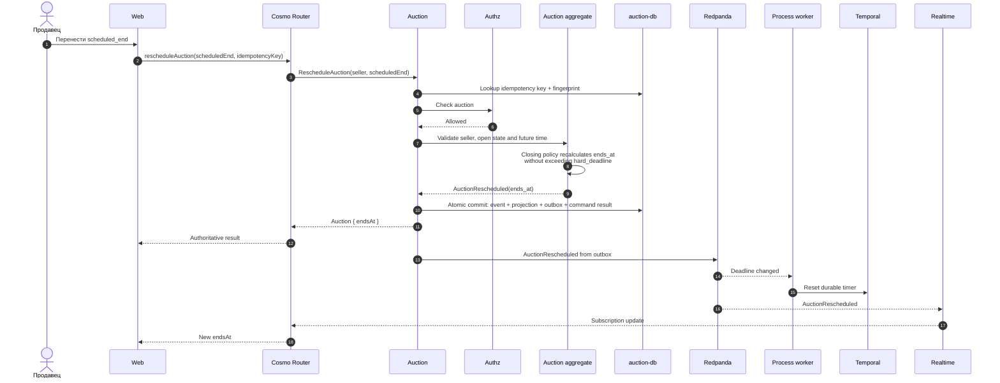

# Продавец меняет время окончания

Контекст: Auction · Актор: продавец · Диаграмма: `flow.c4` → `flow_reschedule`

## Цель
Продавец переносит плановое окончание торгов в любой момент, пока они открыты.

## Правила
- Требуются authoritative permission `auction#reschedule` и совпадение principal с `seller_id` из `AuctionOpened`; обе проверки fail-closed.
- Новое `scheduled_end` строго больше `now`. В прошлое нельзя.
- Можно и приблизить, и отодвинуть. `hard_deadline` не превышается.
- Тип политики (добавить или убрать `inactivity`, поменять `hard_deadline`) — только до первой ставки. После первой ставки меняется только `scheduled_end`.

## Основной сценарий

## Ошибки
- Authz deny или не продавец → `FORBIDDEN`.
- Торги закрыты → `DOMAIN_REJECTED`, reason `not_open`.
- `scheduled_end ≤ now` → `DOMAIN_REJECTED`, reason `deadline_not_future`.
- Смена типа политики после первой ставки → `DOMAIN_REJECTED`, reason `invalid_closing_policy`.
- Повтор того же request возвращает stored result без нового события; key с другим payload → `IDEMPOTENCY_CONFLICT`.

## Инварианты
6, 7. Изменение `scheduled_end` не затрагивает инварианты цены (1–4).
