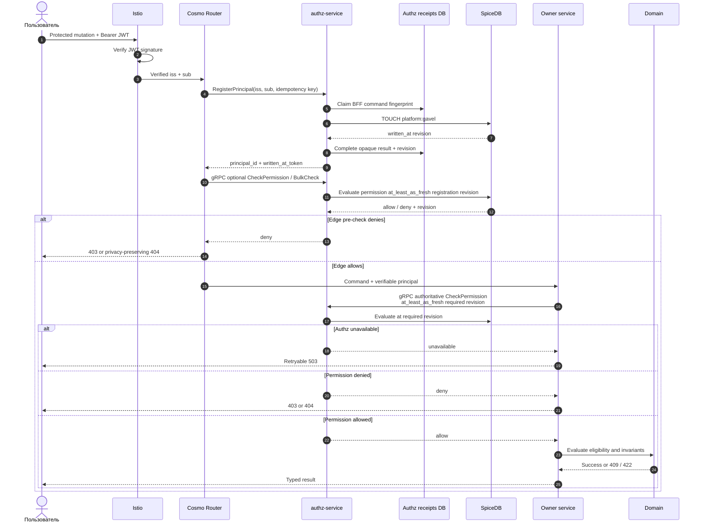

# Авторизовать пользовательскую команду

Контекст: Authz · Участники: BFF, сервис-владелец, SpiceDB · Диаграмма: `flow.c4` → `flow_authorize_command`

## Цель

Не допустить выполнение protected command без permission и при этом не смешать authorization с бизнес-валидацией.

## Сценарий

## Изменение отношений

Owner заранее выделяет resource id и отправляет идемпотентную команду Authz relationship writer. Writer проверяет mTLS workload identity и допустимый resource type, вызывает SpiceDB `WriteRelationships` и возвращает ZedToken. Только после этого owner одной локальной транзакцией сохраняет ресурс, token и outbox; orphan tuple после failed commit безопасно удаляет reconciliation.

Перед SpiceDB Authz claim-ит durable receipt по caller и idempotency key. Exact replay не выполняет второй write; изменённый payload конфликтует; после истечения lease только тот же fingerprint может безопасно повторить TOUCH/delete. BFF владеет registration/`operation`, а Catalog/Auction/Payments/Notify — только своими resource types; Processes relationship writes запрещены.

Local bootstrap использует тот же `RegisterPrincipal` и receipt path для трёх development actors, но отдельную workload identity. Ей разрешён только фиксированный `platform:gavel#process_worker@service_account:processes`; это исключение не разрешает записывать owner resource tuples или administrator.

Для `auction:participant`, который можно определить только после принятия ставки, порядок обратный: domain commit, затем grant. Private read до завершения provisioning fail closed, а повтор команды по idempotency key завершает relationship write.
