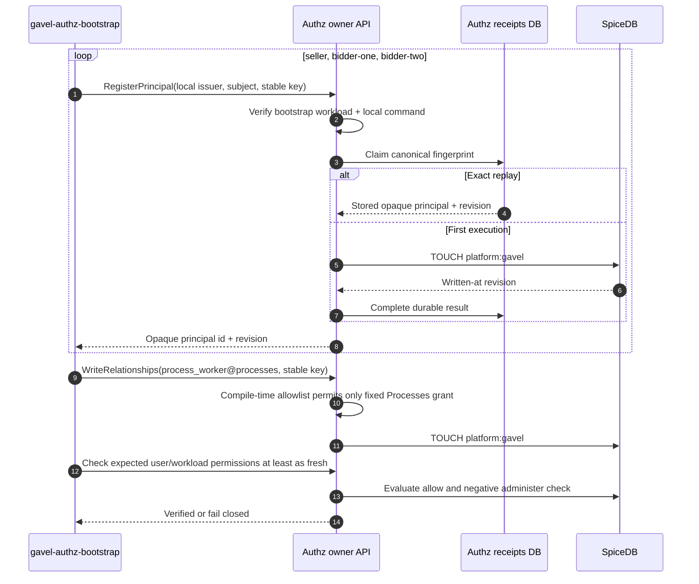

# Локальный Authz bootstrap

Контекст: Authz · Инициатор: Helm post-install/post-upgrade Job · Диаграмма: `flow.c4` → `flow_local_authz_bootstrap`

## Цель

Идемпотентно подготовить seller, двух bidders и минимальный Processes workload grant через owner gRPC-границу Authz, не выдавая seed-скрипту SpiceDB credential и не обходя workload policy.

## Сценарий

Повтор Job использует те же issuer/subjects/idempotency keys и получает сохранённые результаты без новых логических principals или relationship effects. Изменённый payload с прежним key конфликтует в receipt store.

Bootstrap не создаёт `lot`, `auction`, `payment_profile` или notification tuples: эти отношения принадлежат соответствующим owner services и создаются последующим domain seed через их API. Job не получает raw SpiceDB token, не пишет таблицы напрямую и не превращает Processes в administrator.

В local `kind` идентичность Job ограничена отдельным ServiceAccount, NetworkPolicy и development-only trusted pod CIDR. Production profile по умолчанию не рендерит Job и не включает эту identity.
