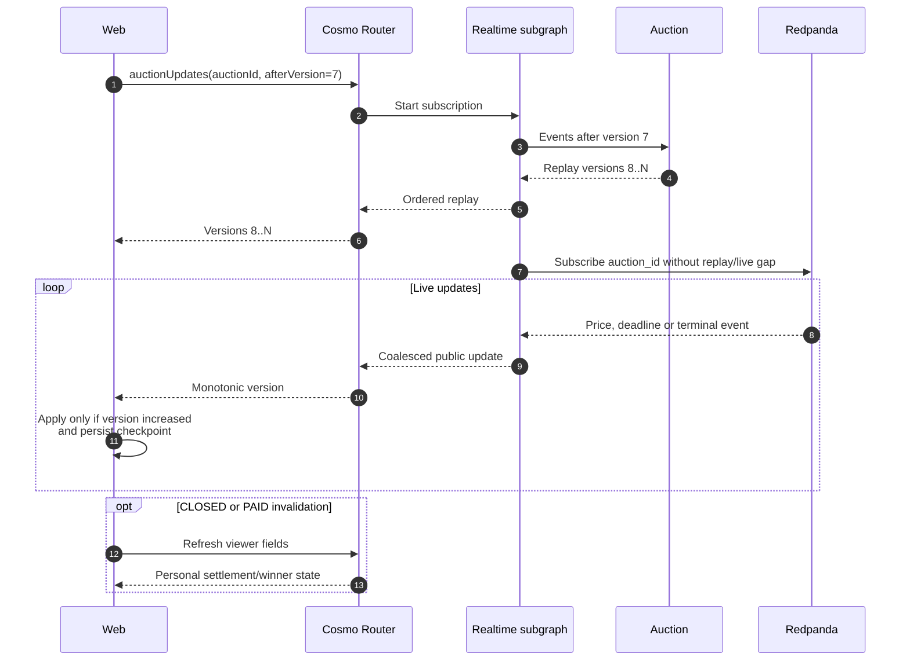

# Живое обновление цены и переподключение subscription

Клиент, оставшийся на странице лота, получает новую публичную цену, изменение дедлайна и terminal status без polling. Публичный transport завершает Cosmo Router, а replay/live semantics скрывает Realtime subgraph.

## Контракт

Клиент вызывает GraphQL subscription `auctionUpdates(auctionId, afterVersion)`. Каждое сообщение содержит монотонную `version`; клиент применяет сообщение только если оно новее уже обработанного и сохраняет checkpoint локально.

При первом подключении `afterVersion` отсутствует. После разрыва клиент переподписывается с последней версией:

Промежуточные price updates hot lot можно coalesce до последней версии. `closed`, `cancelled` и `paid` — terminal events, их coalesce или потеря запрещены.

| Update | Реакция Web |
|---|---|
| `PRICE_CHANGED` | Обновить цену и сохранить `version` |
| `DEADLINE_CHANGED` | Обновить обратный отсчёт |
| `CLOSED` | Показать `settling`, затем запросить персональные viewer fields |
| `PAID` | Повторить query; только `viewer.isWinner = true` показывает «Вы победили» |
| `CANCELLED` | Остановить действия и показать отмену |

Публичный subscription служит также invalidation signal. Личность лидера, секретные максимумы и победитель в общий поток не попадают.

## Отказы

- Router или Realtime subgraph перезапущен → клиент переподписывается с checkpoint.
- Broker временно недоступен → соединение завершается retryable error; replay после восстановления закрывает разрыв.
- Slow consumer → промежуточные цены coalesce, terminal events сохраняются; при превышении лимита соединение закрывается с последней подтверждённой версией.
- Персональный refresh после `CLOSED`/`PAID` не удался → клиент повторяет query и не делает вывод о победе из публичного update.

## Проверка

k6-профиль проверяет concurrent subscriptions, reconnect storm, hot lot fan-out, порядок версий и отсутствие потери terminal events. Подробности — в [ADR-0013](../../../../docs/adr/0013-workload-and-capacity-model.md).

Сценарий: [flow.c4](flow.c4).
