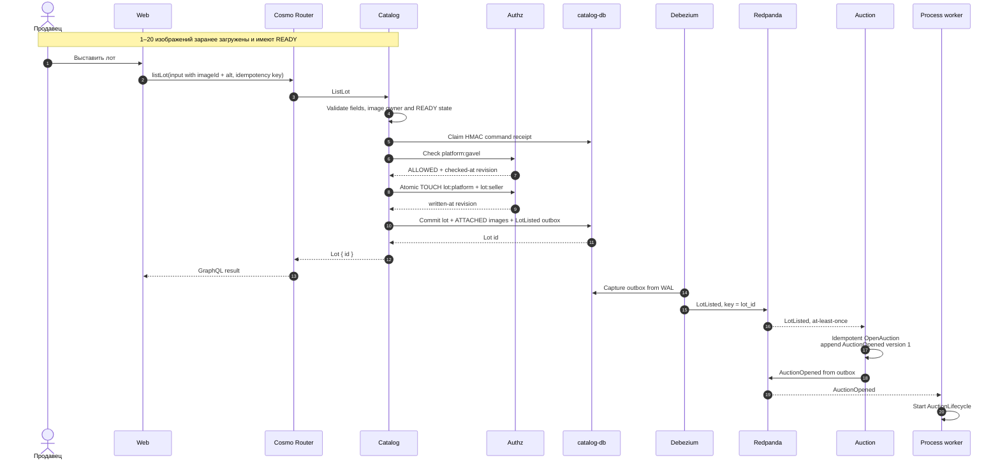

# Выставить лот и открыть торги

Контекст: Catalog → Auction · Актор: продавец · Диаграмма: `flow.c4` → `flow_list_lot`

## Цель
Продавец создаёт лот с описанием, стартовой ценой, шагом и политикой окончания. Торги открываются автоматически.

## Основной сценарий

## Ошибки и граничные случаи
- Consumer идемпотентен по `lot_id`: повторная доставка `LotListed` не открывает второй аукцион.
- Точный повтор команды возвращает durable receipt; тот же ключ с другим payload даёт `idempotency_conflict`.
- GraphQL adapter детерминированно выводит `lot_id` из verified principal и idempotency key, поэтому потерянный ответ не превращает точный повтор в новый intent; server timestamp не входит в canonical client payload.
- Если Authz grant записан, а local commit не состоялся, lease-based reconciliation удаляет его только после proof-of-absence лота.
- Метрики используют только bounded `operation/outcome`; seller/lot/image ids, tokens, URLs и object keys в labels/logs запрещены.
- Политика «только `inactivity`» без `hard_deadline` допустима, UI предупреждает, что торги могут длиться долго.

## Между контекстами только события
Catalog не вызывает Auction синхронно. Задержка открытия торгов — миллисекунды, зато нет распределённой транзакции.
