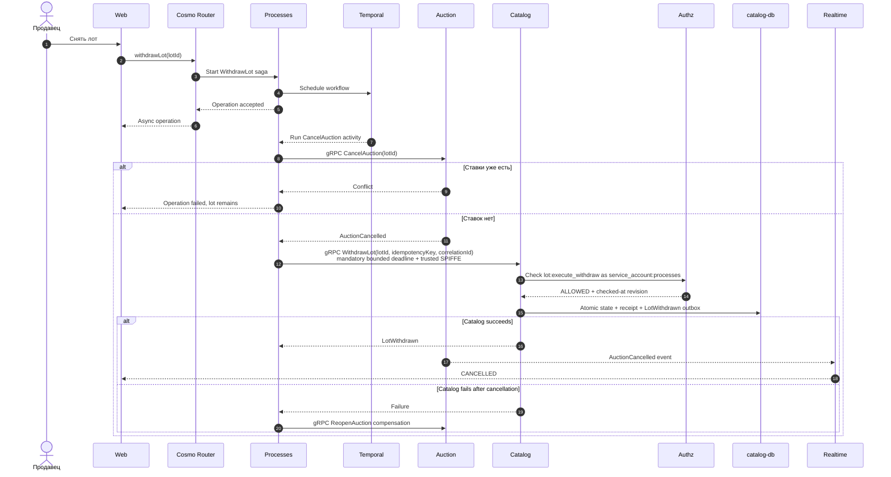

# Снять лот (сага)

Контекст: Catalog + Auction · Актор: продавец · Диаграмма: `flow.c4` → `flow_withdraw_lot`

## Цель
Продавец снимает лот с торгов. Разрешено только пока ставок нет.

## Почему сага
Решение «ставок нет» принадлежит Auction, состояние лота — Catalog. Два контекста, две базы, транзакции между ними нет. Оркестрирует Temporal (`WithdrawLot` в process worker).

## Основной сценарий

## Ошибки
- Не продавец → сага отказывает до первого шага.
- Ставка пришла между шагами 1 и 2 → Auction отвечает `409`, сага отказывает. Гонка решается версией потока.
- Catalog принимает RPC только от trusted-proxy SPIFFE identity `gavel-processes`; raw identity metadata игнорируется.
- Exact replay возвращает прежний typed outcome, dependency failures остаются retryable gRPC status.
- Telemetry содержит только bounded operation/outcome и не содержит lot id, idempotency key, token или credential.

## Результат для клиента
Клиент узнаёт итог по subscription или query статуса `Operation`/лота. Синхронного ответа «снято» нет.
