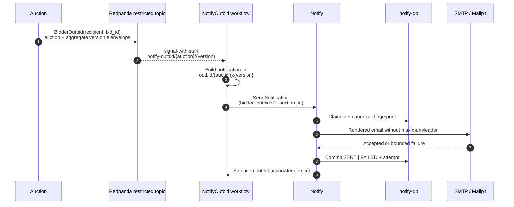

# Уведомление «вас перебили»

Контекст: Notify · Инициатор: Processes · Authoritative decision: Auction · Диаграмма: `flow.c4` → `flow_outbid_notification`

## Цель

Доставить участнику email после того, как authoritative proxy bidding определил потерю лидерства, не раскрывая maximum или identity другого участника и не связывая commit ставки с email provider.

## Сценарий

Auction определяет recipient: прежний лидер при смене лидерства либо автор принятой ставки при immediate proxy outbid. Processes durable повторяет intent, а Notify дедуплицирует точный повтор. Ошибка доставки не меняет ставку, цену или лидера.

Template принимает только `auction_id`. Recipient, notification id, bid id, тело письма и template data не попадают в telemetry labels или обычные логи.
