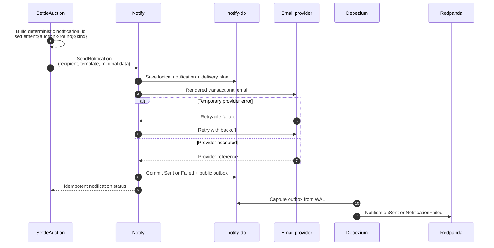

# Settlement-уведомления

Контекст: Notify · Инициатор: Processes · Диаграмма: `flow.c4` → `flow_settlement_notifications`

## Цель

Доставить email при выборе settlement candidate, необходимости восстановить оплату и подтверждении победителя, не связывая workflow с конкретным email provider.

## Сценарий

Повтор команды возвращает состояние исходного уведомления и не создаёт второе письмо.
