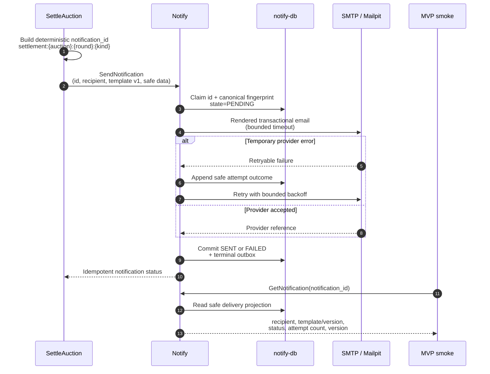

# Settlement-уведомления

Контекст: Notify · Инициатор: Processes · Диаграмма: `flow.c4` → `flow_settlement_notifications`

## Цель

Доставить email при выборе settlement candidate, необходимости восстановить оплату и подтверждении победителя, не связывая workflow с конкретным email provider.

## Сценарий

Точный повтор команды возвращает сохранённый terminal result и не создаёт второе письмо. Notify поддерживает отдельные версии `settlement_candidate.v1`, `settlement_candidate_failed.v1`, `payment_recovery_required.v1` и `winner_confirmed.v1`; решение отправить candidate-failed принимает только Processes после authoritative settlement outcome. Повтор `notification_id` с изменённым recipient, template, version, data либо idempotency key возвращает typed `IDEMPOTENCY_CONFLICT`. Operator read никогда не возвращает template data, recovery URL, provider reference или SMTP body.
