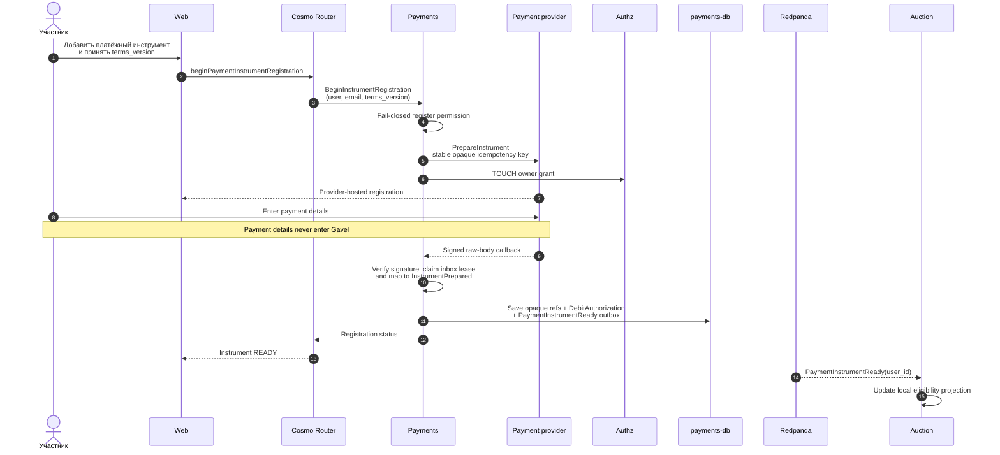

# Подготовить платёжный инструмент до участия в торгах

Контекст: Payments · Актор: участник · Диаграмма: `flow.c4` → `flow_register_payment_instrument`

## Цель

До первой ставки подготовить у выбранного платёжного провайдера повторно используемый инструмент и зафиксировать разрешение участника на автоматическое списание.

## Условия разрешения

Пользователь явно соглашается, что:

- после выбора settlement candidate Gavel попытается списать рассчитанную Auction сумму без присутствия пользователя;
- сумма определяется правилами аукциона и не превышает его принятого максимума;
- если автоматическая оплата не завершилась, Temporal-процесс даёт два часа на восстановление;
- после истечения окна кандидат выбывает, и предложение переходит следующему участнику.

Payments хранит `terms_version` и `accepted_at`. Отзыв разрешения запрещает новые ставки, но не отменяет обязательства по уже принятым ставкам.

## Основной сценарий

## Ошибки и изменения

- Провайдер не подготовил инструмент → он не становится `Ready`, ставка запрещена.
- Ошибка Authz закрывает операцию; grant создаётся до локального commit, а при его отказе выполняется compensating delete. Worker повторно удаляет grant отозванных инструментов.
- Инструмент удалён или разрешение отозвано → `PaymentInstrumentRevoked`; новые ставки запрещены.
- Формально готовый инструмент может не сработать позже; фактическая попытка выполняется только после выбора settlement candidate.
- Callback подтверждается только после durable state/outbox commit. Незавершённый inbox claim возвращает retryable status и после lease может быть безопасно захвачен повторно.
- Повторы регистрации используют один HMAC-derived provider key; неопределённый ответ провайдера или потерянный локальный ответ не создают второй provider session.

## Важное ограничение

Готовность означает возможность попытки будущего списания. Она не резервирует сумму и не гарантирует успешную оплату.
