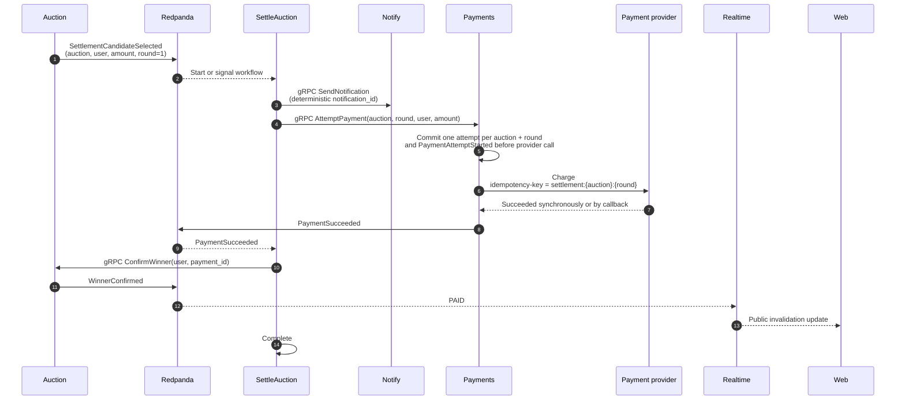
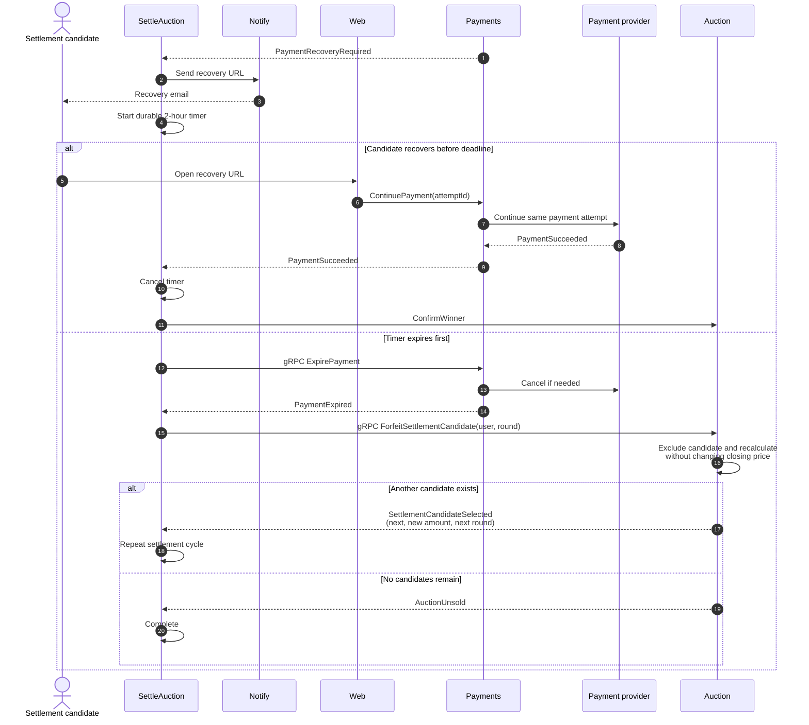

# Завершить расчёт по закрытому аукциону

Владелец процесса: Processes · Участники: Auction, Payments, settlement candidate, время · Диаграмма: `flow.c4` → `flow_payment`

## Цель

После закрытия торгов автоматически получить оплату от первого подходящего участника. Если платёж требует участия пользователя, дать текущему кандидату два часа на восстановление; затем исключить его и повторить процесс со следующим кандидатом.

Temporal владеет последовательностью, таймерами и повторами. Auction владеет кандидатом и суммой. Payments владеет платёжной попыткой и скрывает конкретного провайдера. Notify владеет шаблоном, каналом и delivery retry.

## Термины

- **Settlement candidate** — участник, которому сейчас предлагается купить лот. Это ещё не подтверждённый победитель.
- **Winner** — кандидат, чья оплата успешно завершилась и подтверждена Auction.
- **Settlement round** — номер кандидата в процессе; входит в ключ идемпотентности платежа.
- **Recovery window** — двухчасовой Temporal timer, в течение которого кандидат может продолжить оплату или заменить инструмент.

## Основной сценарий

## Recovery window

Если Payments публикует `PaymentRecoveryRequired`:

## Расчёт settlement amount следующего кандидата

Settlement amount не наследуется от выбывшего кандидата. Auction удаляет его максимум из расчёта и применяет обычную pricing policy к оставшимся ставкам. Поэтому сумма нового кандидата не превышает его максимум. Публичная closing price остаётся частью неизменяемой истории торгов.

Пример: A max 200, B max 150, C max 100, шаг 10. Изначально A платил бы 160. После forfeiture A кандидат B получает цену 110, а не 160.

## Гонки и ошибки

- Повтор activity не создаёт новую попытку: ключ `settlement:{auction_id}:{round}`.
- Дубли callback игнорируются по `provider_event_ref`.
- Успех одновременно с expiry: `ExpirePayment` сначала делает provider query/cancel; подтверждённый успех побеждает. Оптимистическая версия допускает только один terminal commit/outbox event.
- Неопределённый query/cancel не переводит попытку в `Expired`: тот же idempotency receipt освобождается для безопасного повтора.
- Попытку в `Processing` нельзя бросить: workflow ждёт terminal outcome и не переходит к следующему кандидату.
- Провайдер недоступен: activity повторяется с backoff; recovery window начинается только после `PaymentRecoveryRequired`.
- Email не доставлен: recovery URL остаётся на странице лота; timer не продлевается.

## Что не делаем сейчас

Возвраты, выплаты продавцу, штраф за неуспешную оплату, повторный допуск выбывшего кандидата.
